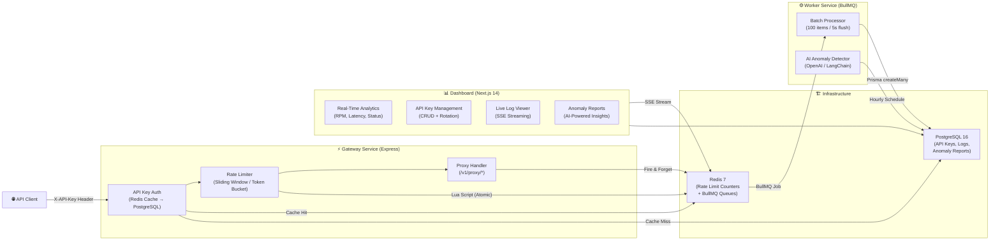

<p align="center">
<pre>
     ██████╗  █████╗ ████████╗███████╗███████╗ ██████╗ ██████╗  ██████╗ ███████╗
    ██╔════╝ ██╔══██╗╚══██╔══╝██╔════╝██╔════╝██╔═══██╗██╔══██╗██╔════╝ ██╔════╝
    ██║  ███╗███████║   ██║   █████╗  █████╗  ██║   ██║██████╔╝██║  ███╗█████╗  
    ██║   ██║██╔══██║   ██║   ██╔══╝  ██╔══╝  ██║   ██║██╔══██╗██║   ██║██╔══╝  
    ╚██████╔╝██║  ██║   ██║   ███████╗██║     ╚██████╔╝██║  ██║╚██████╔╝███████╗
     ╚═════╝ ╚═╝  ╚═╝   ╚═╝   ╚══════╝╚═╝      ╚═════╝ ╚═╝  ╚═╝ ╚═════╝ ╚══════╝
</pre>
</p>

<p align="center">
  <strong>An intelligent, production-grade API gateway with per-key rate limiting, real-time analytics, and AI-powered anomaly detection.</strong>
</p>

<p align="center">
  
  
  
  
  
  
  
  
</p>

---

## What is GateForge?

GateForge is a full-stack API gateway that sits between your clients and your backend services. It authenticates every request via API keys, enforces per-key rate limits using Redis-backed algorithms (sliding window + token bucket), queues telemetry data through BullMQ for async persistence, and provides a real-time analytics dashboard powered by Next.js 14. An LLM-powered anomaly detector runs on a recurring schedule to surface suspicious traffic patterns before they become incidents.

Built as a monorepo with three microservices, a shared Prisma schema, Docker Compose orchestration, and a comprehensive integration test suite — this project demonstrates production-quality distributed systems design from end to end.

---

## Architecture



### Request Flow (Step by Step)

```
1. Client sends GET /v1/proxy/users/profile with X-API-Key header
2. Gateway checks Redis cache for key → falls back to PostgreSQL on miss
3. Rate limiter runs an atomic Lua script against Redis ZSET (sliding window)
4. If under quota → proxy forwards the request to upstream service
5. Response fires a "finish" event → log job is enqueued to BullMQ (zero latency impact)
6. Worker batches 100 jobs (or flushes every 5s) → bulk INSERT into PostgreSQL
7. Dashboard queries PostgreSQL aggregations for real-time charts
8. AI analyzer runs hourly → LLM evaluates traffic patterns → stores anomaly reports
```

---

## Features

### Gateway & Proxy
- [x] **API Key Authentication** — Redis-cached credential validation with 60s TTL
- [x] **Per-Key Rate Limiting** — Sliding window (ZSET + Lua) and token bucket algorithms
- [x] **Upstream Proxying** — Configurable target forwarding with 502 Bad Gateway handling
- [x] **Rate Limit Headers** — Standard `X-RateLimit-*` and `Retry-After` headers
- [x] **Graceful Shutdown** — SIGTERM/SIGINT handlers drain connections cleanly

### API Key Management
- [x] **Full CRUD** — Create, list (masked), update, and revoke API keys
- [x] **Key Rotation** — Generate new secrets with instant old-key invalidation
- [x] **Scope-Based Authorization** — READ, WRITE, ADMIN permission scopes
- [x] **7-Day Usage Sparklines** — Per-key request volume mini-charts

### Async Telemetry & Logging
- [x] **Zero-Latency Logging** — Fire-and-forget BullMQ enqueue on response finish
- [x] **Batch Processing** — Worker accumulates 100 items before bulk insert
- [x] **Dead Letter Queue** — Failed jobs routed to DLQ with diagnostic metadata
- [x] **Worker Metrics** — Jobs/min, failure rate, batch size reported to stdout

### Analytics & Monitoring
- [x] **Statistical Aggregation** — p50/p95/p99 latency percentiles via `PERCENTILE_CONT`
- [x] **Time-Series Charts** — RPM, latency, and status code distribution over time
- [x] **Top API Keys by Usage** — Ranked by request volume with error rate breakdown
- [x] **Cursor-Based Pagination** — Efficient log browsing for high-volume datasets
- [x] **Live SSE Streaming** — Real-time log events via Server-Sent Events

### AI Anomaly Detection
- [x] **LLM-Powered Analysis** — OpenAI + LangChain evaluates traffic for anomalies
- [x] **Structured Output** — Zod-validated anomaly reports with severity levels
- [x] **Scheduled Hourly Runs** — BullMQ repeatable job with manual trigger API
- [x] **Anomaly Dashboard** — Filterable report viewer with severity badges

### Infrastructure & DevOps
- [x] **Docker Multi-Stage Builds** — ~150 MB production images (vs ~800 MB naive)
- [x] **Docker Compose Orchestration** — One-command dev and production environments
- [x] **Health Checks** — pg_isready, redis-cli ping, HTTP endpoint probes
- [x] **Integration Test Suite** — 41 tests against live PostgreSQL + Redis

---

## Tech Stack

| Layer | Technology | Why This Choice |
|:------|:-----------|:----------------|
| **Gateway** | Express 4 + TypeScript | Minimal overhead for a proxy server; middleware pipeline maps naturally to auth → rate-limit → forward |
| **Rate Limiting** | Redis 7 + Lua Scripts | Atomic sorted-set operations execute in <1ms; Lua scripts guarantee no race conditions under concurrency |
| **Queue** | BullMQ | Redis-backed job queue with built-in retries, backoff, repeatable schedules, and dead letter queues |
| **Database** | PostgreSQL 16 | ACID transactions for key management; `PERCENTILE_CONT` for efficient p95/p99 aggregation in a single query |
| **ORM** | Prisma 5 | Type-safe database client with auto-generated TypeScript types from the schema; raw SQL escape hatch for analytics |
| **Dashboard** | Next.js 14 (App Router) | Server components for initial data fetching; client components only for interactive charts and state |
| **Charts** | Tremor React | Pre-built dashboard components (area charts, bar lists, badges) optimized for analytics UIs |
| **AI** | LangChain + OpenAI | Structured output parsing with Zod schemas; LangChain abstracts model swapping (GPT-4 → Claude → local) |
| **Testing** | Jest + Supertest | In-process HTTP testing without port binding; `--runInBand` ensures sequential test execution for shared DB state |
| **Containers** | Docker + Docker Compose | Multi-stage builds for minimal images; compose orchestrates all 5 services with health-gated dependencies |

---

## Quick Start

### Prerequisites

- [Docker Desktop](https://www.docker.com/products/docker-desktop/) (or Docker Engine + Compose plugin)
- [Node.js 20+](https://nodejs.org/) (for local development)

### One-Command Start (Docker)

```bash
# Clone the repository
git clone https://github.com/your-username/gateforge.git
cd gateforge

# Copy environment template
cp .env.example .env

# Start everything (PostgreSQL, Redis, Gateway, Worker, Dashboard)
make dev
```

That's it. Services are available at:

| Service | URL | Description |
|:--------|:----|:------------|
| Gateway | `http://localhost:3000` | API proxy endpoint |
| Dashboard | `http://localhost:3001` | Analytics & management UI |
| PostgreSQL | `localhost:5432` | Database (user: `gateforge_user`) |
| Redis | `localhost:6379` | Cache & queue store |

### Local Development (Without Docker)

```bash
# Install dependencies
npm install

# Start infrastructure containers only
docker compose up postgres redis -d

# Push Prisma schema to database
npm run db:push

# Seed initial data
npm run db:seed

# Start services (each in a separate terminal)
npm run dev:gateway    # → http://localhost:3000
npm run dev:worker     # → Background job consumer
npm run dev:dashboard  # → http://localhost:3001
```

### Verify It Works

```bash
# Health check
curl http://localhost:3000/health

# Create an API key (using the built-in admin key)
curl -X POST http://localhost:3000/api/keys \
  -H "X-API-Key: gf_admin_dashboard_key" \
  -H "Content-Type: application/json" \
  -d '{"name": "My First Key", "scopes": ["READ"], "rateLimit": 100}'

# Use the returned key to make a proxied request
curl http://localhost:3000/v1/proxy/hello \
  -H "X-API-Key: gf_live_<your-key-here>"
```

### Makefile Commands

```bash
make dev              # Start all services with hot-reload
make build            # Build production Docker images
make test             # Run integration test suite
make logs             # Tail all service logs
make migrate          # Apply pending database migrations
make down             # Stop services (data preserved)
make down-volumes     # Stop services + delete data ⚠️
make ps               # Show container status
make help             # List all available commands
```

---

## API Reference

All endpoints require the `X-API-Key` header. Admin endpoints require a key with `ADMIN` scope.

### Health & Proxy

| Method | Endpoint | Auth | Description |
|:-------|:---------|:-----|:------------|
| `GET` | `/health` | None | Service health check (used by Docker/K8s probes) |
| `ALL` | `/v1/proxy/*` | API Key | Authenticated proxy route — forwards to upstream target |

### API Key Management — `/api/keys`

| Method | Endpoint | Auth | Description |
|:-------|:---------|:-----|:------------|
| `POST` | `/api/keys` | Admin | Create a new API key (returns plaintext secret once) |
| `GET` | `/api/keys` | Admin | List all keys (secrets masked) with 7-day usage sparklines |
| `PATCH` | `/api/keys/:id` | Admin | Update key name, scopes, rate limit, or active status |
| `DELETE` | `/api/keys/:id` | Admin | Revoke key (soft delete — sets `isActive: false`) |
| `POST` | `/api/keys/:id/rotate` | Admin | Generate new secret, instantly invalidate old one |

### Request Logs — `/api/logs`

| Method | Endpoint | Auth | Description |
|:-------|:---------|:-----|:------------|
| `GET` | `/api/logs` | Admin | Paginated log list with cursor, status, method, and date filters |
| `GET` | `/api/logs/stats` | Admin | Aggregate stats: throughput, p50/p95/p99, error rates, time-series |
| `GET` | `/api/logs/analytics` | Admin | Full analytics: RPM series, latency percentiles, top keys, geo distribution |
| `GET` | `/api/logs/stream` | Admin | Live SSE stream of incoming request logs |
| `GET` | `/api/logs/:id` | Admin | Single log detail with associated API key metadata |

### AI Anomaly Detection — `/api/anomalies`

| Method | Endpoint | Auth | Description |
|:-------|:---------|:-----|:------------|
| `GET` | `/api/anomalies` | Admin | List anomaly reports, filtered by severity and date range |
| `POST` | `/api/anomalies/run` | Admin | Trigger an on-demand AI traffic analysis (async via BullMQ) |

---

## Dashboard Screenshots

> 📸 *Screenshots will be added after the dashboard UI is connected to live data.*

| Page | Description |
|:-----|:------------|
| **Analytics Overview** | RPM time-series chart, latency percentile heatmap, status code distribution, top keys by volume |
| **API Key Management** | Key list with masked secrets, scope badges, rate limit configs, 7-day usage sparklines |
| **Log Explorer** | Paginated log table with method/status/latency columns, filter bar, cursor pagination |
| **Anomaly Reports** | AI-generated anomaly cards with severity indicators, affected endpoints, and remediation suggestions |

---

## Performance Benchmarks

> 🏎️ *Benchmarks will be populated after load testing with [k6](https://k6.io/) or [autocannon](https://github.com/mcollina/autocannon).*

| Metric | Target | Measured |
|:-------|:-------|:---------|
| Gateway throughput (req/s) | >5,000 | *TBD* |
| Rate limit check latency (p99) | <5ms | *TBD* |
| Auth cache hit ratio | >95% | *TBD* |
| Worker batch flush (100 records) | <50ms | *TBD* |
| Dashboard TTFB (server component) | <200ms | *TBD* |
| Docker image size (gateway) | <200MB | *TBD* |
| Docker image size (dashboard) | <350MB | *TBD* |

---

## Design Decisions

### 1. Sliding Window via Redis Sorted Sets (not Fixed Window Counters)

**The choice:** Rate limits are enforced using Redis `ZSET` sorted sets with member scores set to request timestamps, pruned atomically inside a Lua script.

**Why not a simpler fixed window counter?** Fixed windows suffer from the "boundary burst" problem — a client can send 100 requests at second 59 and another 100 at second 61, getting 200 requests through in 2 seconds despite a 100/minute limit. The sliding window treats time as a continuous range, counting only requests within the last `N` seconds from *right now*. The Lua script executes atomically inside Redis (single-threaded), eliminating race conditions even under concurrent load.

**Tradeoff:** Sorted sets consume more memory than simple counters (each member stores a UUID + timestamp score), but the accuracy guarantee is worth it for a security-critical component.

### 2. Fire-and-Forget Log Enqueue (not Synchronous Database Writes)

**The choice:** When a proxied request completes, the gateway enqueues a BullMQ job on the Express `res.on('finish')` event and does **not** `await` the result.

**Why?** The gateway's primary job is low-latency proxying. Adding a synchronous PostgreSQL write to every request would add 5-20ms of latency and create a direct coupling — if the database slows down, proxy latency spikes for every client. By fire-and-forgetting into Redis (sub-millisecond), the gateway stays fast regardless of database health. The worker batches 100 records into a single `createMany` call, converting 100 round-trips into 1.

**Tradeoff:** Logs are eventually consistent (up to a 5-second batch window delay). For an analytics pipeline, this is acceptable; for a billing system, it would not be.

### 3. Separate Worker Process (not In-Process Background Threads)

**The choice:** The BullMQ consumer runs as a completely separate Node.js process (`packages/worker`), not as a background task inside the gateway process.

**Why?** Process isolation ensures that if the worker encounters a memory leak, an unhandled exception, or a slow LLM call, the gateway proxy continues serving traffic unaffected. This mirrors production patterns at companies like Stripe (separate billing workers) and GitHub (separate webhook delivery workers). It also allows independent scaling — in Kubernetes, you can run 1 gateway pod and 5 worker pods.

**Tradeoff:** Adds operational complexity (another container to monitor), but Docker Compose makes this trivial for development.

### 4. Next.js Standalone Output (not Traditional `next start`)

**The choice:** The dashboard Dockerfile uses `output: 'standalone'` in `next.config.js`, producing a self-contained `server.js` that bundles only the traced runtime dependencies.

**Why?** A standard Next.js production image copies the entire `node_modules` tree (~500 MB+). Standalone mode uses `@vercel/nft` (Node File Tracing) to analyze `require()` calls and copy only the files actually imported at runtime. This reduces the Docker image from ~1 GB to ~200-300 MB — a 3-4x reduction in image pull time and storage cost.

---

## What I Learned

Building GateForge from scratch taught me more about distributed systems than any textbook could. Here are the most impactful lessons:

**Redis is not just a cache.** Before this project, I thought of Redis as "fast key-value storage." Building the rate limiter forced me to learn Lua scripting, sorted set semantics, and atomic multi-key operations. The moment I realized a Lua script executes without interruption on Redis's single thread — eliminating the need for distributed locks — was a genuine "aha" moment. It completely changed how I think about concurrency.

**The "fire-and-forget" pattern has real engineering depth.** It sounds simple: "don't await the log write." But getting it right means handling queue backpressure, dead letter routing for permanently failed jobs, batch flushing timers, graceful shutdown drain sequences, and metrics reporting. Each layer exists because a previous version of the code silently dropped data in a specific failure mode.

**Integration tests catch what unit tests miss.** My unit tests all passed, but the integration suite immediately caught a foreign key constraint violation — the virtual admin key ID (`00000000-0000-0000-0000-000000000000`) doesn't exist in the `ApiKey` table, so logging a request made with it crashed the worker's `createMany` call. No amount of Zod schema validation or mock testing would have found this; it only surfaces when real PostgreSQL enforces real referential integrity.

**Docker multi-stage builds are a multiplier.** My first Dockerfiles were ~800 MB images that took 3 minutes to build. After learning multi-stage builds, the same services compile to ~150 MB images with 30-second builds. The key insight: the TypeScript compiler, test runner, and dev dependencies never need to exist in the production image. "Build in one container, run in another" is now permanently in my mental toolkit.

---

## Future Improvements

- [ ] **Circuit Breaker Pattern** — Wrap upstream proxy calls with a circuit breaker (Opossum) to fail fast when backends are degraded
- [ ] **WebSocket Support** — Extend the proxy to handle persistent WebSocket connections with per-connection rate limiting
- [ ] **API Versioning** — Support `/v2/proxy/*` with breaking-change isolation and gradual client migration
- [ ] **Distributed Rate Limiting** — Shard rate limit state across multiple Redis nodes using consistent hashing for horizontal scaling
- [ ] **IP Geolocation** — Integrate MaxMind GeoIP2 for real geographic distribution data (replacing the deterministic hash fallback)
- [ ] **Request/Response Logging** — Capture and store request bodies and response payloads (with PII redaction) for full audit trails
- [ ] **Grafana + Prometheus** — Export worker metrics and gateway latencies as Prometheus counters for Grafana dashboarding
- [ ] **Load Testing Suite** — k6 scripts simulating realistic traffic patterns (burst, ramp-up, sustained) with CI/CD integration
- [ ] **RBAC Dashboard Auth** — Replace the static admin key with NextAuth.js session-based authentication for the dashboard
- [ ] **Plugin System** — Allow custom middleware injection (request transforms, response enrichment) without forking the gateway

---

## Project Structure

```
gateforge/
├── packages/
│   ├── gateway/                 # Express proxy + auth + rate limiting
│   │   ├── src/
│   │   │   ├── auth/            # API key validation, scope enforcement
│   │   │   ├── rateLimit/       # Sliding window, token bucket, middleware
│   │   │   ├── routes/          # Key CRUD, log queries, anomaly endpoints
│   │   │   ├── queue/           # BullMQ log producer
│   │   │   ├── lib/             # Prisma & Redis singletons
│   │   │   └── utils/           # Key generation, masking
│   │   └── tests/
│   │       ├── integration/     # Full lifecycle E2E tests (Supertest)
│   │       ├── fixtures/        # Database seeding & cleanup utilities
│   │       ├── slidingWindow.test.ts
│   │       ├── tokenBucket.test.ts
│   │       ├── rateLimiter.test.ts
│   │       └── logRoutes.test.ts
│   ├── worker/                  # BullMQ consumer + AI anomaly analyzer
│   │   ├── src/
│   │   │   ├── processors/      # Batch log processor, DLQ handler
│   │   │   ├── ai/              # LangChain traffic analyzer
│   │   │   └── lib/             # Redis & Prisma connections
│   │   └── Dockerfile
│   └── dashboard/               # Next.js 14 App Router analytics UI
│       ├── src/app/
│       │   ├── analytics/       # Time-series charts, latency heatmaps
│       │   ├── anomalies/       # AI anomaly report viewer
│       │   ├── keys/            # API key management table
│       │   ├── logs/            # Paginated log explorer
│       │   └── api/             # Next.js API routes (proxy to gateway)
│       └── Dockerfile
├── prisma/
│   ├── schema.prisma            # Shared data model (ApiKey, RequestLog, etc.)
│   └── seed.ts                  # Development database seeder
├── docker-compose.yml           # Production service orchestration
├── docker-compose.dev.yml       # Development overrides (hot-reload, debug ports)
├── Makefile                     # Developer convenience commands
└── .env.example                 # Environment variable template
```

---

## Running Tests

```bash
# Run the full test suite (requires PostgreSQL + Redis running)
npm test --workspace=packages/gateway

# Run only integration tests
npx jest tests/integration/ --runInBand --forceExit

# Run only unit tests (rate limiters, schema validation)
npx jest tests/slidingWindow.test.ts tests/tokenBucket.test.ts tests/logRoutes.test.ts --runInBand
```

**Current test results:**
```
Test Suites: 5 passed, 5 total
Tests:       41 passed, 41 total
Time:        ~12s
```

---

## License

MIT

---

<p align="center">
  Built with ☕ and curiosity.
</p>
